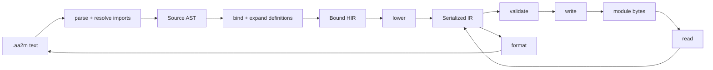

# Architecture

The compiler separates source intent, resolved meaning, and serialized fields.
The package root exposes nothing; modules are grouped by responsibility into
layered packages. The product ships as a standalone
CLI and LSP server, with no supported Python embedding compatibility contract.

Glossary:
- `AST`: Abstract Syntax Tree, a tree of source constructs with names, operators, and spans.
- `HIR`: High-level Intermediate Representation, a tree of typed expressions and statements with resolved names and explicit defaults.
- `SIR`: Serialized Intermediate Representation, a tree of records with confirmed binary fields and IDs. SIR is the logical projection of the binary format, separate from the codec.

Validation produces diagnostics without changing SIR. Formatting reads SIR
directly and selects readable syntax only when it preserves serialized fields.

## Code map

Packages sit in numbered layers. Each layer imports only from its own or lower
layers. [`tools/check_layers.py`](../tools/check_layers.py) (`LAYERS`, part of `mise run
lint`) enforces this, plus the lazy-import, private-import and
import-cycle rules. The one tolerated exception is the CLI's lazy
`cli.main -> lsp.server.run` import, which keeps pygls out of CLI startup.

| Layer | Package | Owns |
| --- | --- | --- |
| 0 | [`core/`](../aa2modulus/core/) | Source and binary locations, diagnostic values, and source-name lexical rules. `version.py` is also layer 0. |
| 1 | [`model/`](../aa2modulus/model/) | SIR records, typed values and binary32 bits, registry metadata records, shared type/value display text, and control-flow action IDs. |
| 2 | [`binary/`](../aa2modulus/binary/) | Metadata-independent binary reader and writer with shared limit checks (`codec.py`); wire layout and loader evidence in [native format](native-format.md). |
| 2 | [`metadata/`](../aa2modulus/metadata/) | Generated registry resources, the registry loader and shape checks, the indexed snapshot, native identities, lookup protocols, and registry schemas/errors. |
| 3 | [`language/`](../aa2modulus/language/) | The source-language policy (`policy.toml`): its model (`LanguagePolicy`), TOML reader, registry cross-checks, loader, operator table, source types (`types.py`: `card`, widening, role-derived signatures), documentation keys, and the language catalog. |
| 4 | [`validation/`](../aa2modulus/validation/) | Strict/native semantic validation (`validator/`: reporter, labels, scope, expression, event-value, statement and module checks, suggested global declarations) and native GUI projection. |
| 5 | [`context/`](../aa2modulus/context/) | `SourceContext` (resolved metadata, policy, catalog, limits and import resolution), source budgets and their located error, and the import resolver protocol. |
| 6 | [`syntax/`](../aa2modulus/syntax/) | Grammar, the parser package (`parser/`: engine, errors, entry points, and a transformer split into one mixin per grammar area), Source AST, AST walking (`walk.py`), qualified-name spans, import resolution, and text/tree/AST budgets. |
| 6 | [`syntax/recovery.py`](../aa2modulus/syntax/recovery.py) | Bounded LALR checkpoint/rollback recovery over production tokens, shared by the editor's current-buffer view and the strict path's every-syntax-error report (`syntax_diagnostics`). |
| 6 | [`syntax/lexicon.py`](../aa2modulus/syntax/lexicon.py) | The lexicon: every grammar literal classified into one group, the literal patterns and comments, and the syntax fingerprint the server advertises; a grammar change that the classification table does not cover raises. |
| 6 | [`syntax/hints.py`](../aa2modulus/syntax/hints.py) | Help and exact fixes for common mistakes from other languages: syntax hints probe the failed parser state; the keyword table is shared with the binder's unknown-name paths. |
| 7 | [`hir/`](../aa2modulus/hir/) | Bound HIR nodes, recorded symbol references and resolved constants, the binding work budget and HIR budgets. |
| 8 | [`lowering/`](../aa2modulus/lowering/) | HIR to SIR: expressions, events and GUI action trees, modules. |
| 9 | [`semantics/`](../aa2modulus/semantics/) | Binding (`binding/`: state, reporting, rewrites, suggestions, values, declarations, constants, members, expressions, checks, macro calls, targets, statements, triggers, definitions, module, authoring), definition expansion, and `@allow` acknowledgement. |
| 9 | [`semantics/allows.py`](../aa2modulus/semantics/allows.py) | `@allow` acknowledgement: downgrades covered hazard errors after validation (and in definition validation) and reports the attributes' own findings. |
| 9 | [`decompile/`](../aa2modulus/decompile/) | Formatting (decompilation) of SIR to source text (`format/`: text, context, cards, expressions, inference, fallbacks, statements, module). |
| 10 | [`pipeline/`](../aa2modulus/pipeline/) | Compiler drivers: [`analysis.py`](../aa2modulus/pipeline/analysis.py) is the shared driver retaining completed stages, diagnostics, and resolved import edges for editor consumers; `authoring.py` is the current-buffer editor view. |
| 11 | [`app/`](../aa2modulus/app/) | Application use cases: validate/compile source (`compile.py`), recover source with diagnostics (`decompile.py`), and the editor built-ins catalog with compile-checked examples, its Markdown pages and ranked search (`editor_catalog/`), and the editor lexicon document (`editor_lexicon.py`). |
| 12 | [`cli/`](../aa2modulus/cli/) | Commands (`commands/`), argument parsing, streams, exit codes, inspection, and diagnostic rendering (`render/`). |
| 12 | [`lsp/`](../aa2modulus/lsp/) | Stdio protocol (`server/`, `protocol/`), versioned buffers (`workspace/`), import overlays/invalidation, diagnostic ownership, compiler-backed authoring, completion, signature help, documentation, references/rename (`features/`), module commands (`commands/`) and the lazy workspace index. |
| 13 | [`aa2modulus/__init__.py`](../aa2modulus/__init__.py) | Docstring only; the root re-exports nothing. Import from the owning module. |

Maintenance and test locations:

| Location | Responsibility |
| --- | --- |
| [`tools/`](../tools/) | Explicit maintenance scripts, one job each; each script's components live in its own package. |
| [`tools/generate_registry.py`](../tools/generate_registry.py), [`tools/registry/`](../tools/registry/) | Registry generation and `--check` from a pinned AAUnlimited source checkout given with `--source-root`: C++ table reading and manifest writing. |
| [`tools/export_reference.py`](../tools/export_reference.py), [`tools/reference/`](../tools/reference/) | Portable reference bundle export from committed contracts, examples, registry and policy. |
| [`tools/build.py`](../tools/build.py), [`tools/standalone/`](../tools/standalone/) | Native single-file executable build script; its notice and version smoke-check components. |
| [`tools/check_layers.py`](../tools/check_layers.py) | Package layer, lazy-import, private-import and import-cycle check (part of `mise run lint`). |
| [`tests/`](../tests/) | Scenario tests grouped by source, binary, metadata, CLI, and LSP; shared helpers in support/. The standalone interfaces define the product contract, not a Python embedding API. |

## Representations and invariants

- [Source AST](../aa2modulus/syntax/ast.py) preserves names, operators, omitted
  arguments, grouping, spans, imports, definitions, and raw payloads.
- [Bound HIR](../aa2modulus/hir/nodes.py) holds selected identities, typed
  expressions, explicit defaults, expanded statements, and source control flow.
  Its types are source types: `card` (a non-int enum, so code typed for wire
  `TypeId` cannot receive it) appears on variables, declarations, card-role
  calls and `Card(...)`; lowering writes `int`. Definitions and diagnostics do
  not become serialized records.
- [SIR](../aa2modulus/model/records.py) mirrors confirmed binary fields. Constructors
  enforce structural/payload invariants; unknown IDs survive absent metadata.
  Equality and logical IR exclude provenance, locations, and resolved metadata.
  Value equality preserves exact binary32 bits, including NaN payloads.

`to_ir`/`from_ir` are logical projections, separate from the binary codec.
Restoring logical IR does not restore annotations. Model and location modules
never import loaders, source passes, or codecs.

## Rule owners

| Rule | Owner |
| --- | --- |
| Fixed syntax, precedence, literals, and spans | [grammar](../aa2modulus/syntax/grammar/unified.lark), [parser](../aa2modulus/syntax/parser/), [operator table](../aa2modulus/language/operators.py) |
| Name/type resolution, complete-trigger scope, defaults, definition validation, template hygiene, receiver-call lowering into native argument vectors | [binding](../aa2modulus/semantics/binding/) |
| Definition dependencies, typed substitution, expansion preflight | [expansion](../aa2modulus/semantics/expansion.py) |
| Explicit library access, canonical identity, import graph, and origins | [imports](../aa2modulus/syntax/imports.py) |
| HIR to native IDs and nested GUI trees; `card` to `int` | [lowering](../aa2modulus/lowering/) |
| Strict authoring and pinned native checks | [validator](../aa2modulus/validation/validator/) |
| Safe readable projection, raw fallbacks, unsupported projection errors, and `card` inference with `Card(...)` conversions | [formatter](../aa2modulus/decompile/format/module.py) |
| Native GUI display, conservative fallbacks, and inspection grouping using fixed operator precedence | [inspection](../aa2modulus/cli/inspection.py) |
| Wire order, widths, payloads, and codec limits ([layout](native-format.md)) | [reader](../aa2modulus/binary/reader.py), [writer](../aa2modulus/binary/writer.py) |
| Configuration conflicts and source resource budgets | [context](../aa2modulus/context/operation.py), [limits](../aa2modulus/context/limits.py), [syntax budgets](../aa2modulus/syntax/limits.py), [binding/HIR budgets](../aa2modulus/hir/limits.py) |
| Registry JSON validation and typed construction | [registry](../aa2modulus/metadata/registry.py) |
| Immutable native row/wire targets and source candidates | [catalog](../aa2modulus/language/catalog/), [identities](../aa2modulus/metadata/identities.py) |
| Policy TOML reading, derived signatures, receiver member-form schema and slot-0 mapping, registry cross-checks | [policy reader](../aa2modulus/language/reader.py), [policy model](../aa2modulus/language/policy.py), [policy values](../aa2modulus/language/values.py), [policy validation](../aa2modulus/language/validation/) |
| Native GUI flattening and located discarded controls | [projection](../aa2modulus/validation/projection.py) |

Globals precede all locals in a trigger's complete declaration vector. Definition
formals bind in isolated scopes; actuals substitute already-bound HIR expressions.
Repeated arguments evaluate at each use, and unused arguments still type-check.
Raw arguments validate before substitution can discard them. Template-local
renaming affects definition-owned records, preserving caller-bound identities.
The [language reference](language.md) owns the full macro/import/template rules.

The parser retains one lazily constructed fixed grammar with independent
per-call parser/transformer state. Context reuse retains configuration, while
symbols, import graphs, budgets, and diagnostics remain operation-local.
Iterative text/tree/AST/HIR checks precede recursive passes; supported depth
ceilings protect those passes without changing Python's recursion limit.

The internal `analyze_source` operation retains the authored root AST, composed
AST, Bound HIR, and SIR as each stage completes. Input failures preserve earlier
stages and the original exception; unexpected exceptions propagate. Import edges
include resolved targets whose reads fail, allowing future editor invalidation to
observe missing libraries. Resolution failures without an identity have no edge.
Application validation/compilation uses its strict diagnostics; decompilation
skips final semantic validation when it locates findings in recovered text.
Library analysis retains an internal empty module for definition checks, while
application APIs continue to return no library module output. Each analysis is
operation-local and retains its exact input text for semantic freshness checks.

Strict binding collects independent errors at statement and item boundaries
(`bind_or_record` in `semantics/binding/reporting.py`); failed declarations stay in scope and failed macros or
templates are poisoned, so uses add no cascading errors. A call with a single
candidate binds all its arguments and fails with every argument error
(`bind_arguments`); other expression binding and overload trials still raise
the first. The editor's authoring view sets no collector and keeps its own
recovery.

Binding records authored name uses and their selected declaration or registry
metadata in nonserialized `BoundModule.references`. Speculative overloads keep
separate reference lists and commit only the unique successful selection. A shared
operation budget charges expression visits and candidate attempts, including
rejected speculative work. Definitions
record uses once in their isolated scopes; expansion creates no navigation
records for generated names.

The CLI loads the LSP package and Pygls only for `lsp-server`. Each stdio session
owns immutable document snapshots and a single compiler worker that debounces
(200 ms) and coalesces pending roots; superseded buffer/dependency work is
discarded, and request cancellation never shares mutable compiler state. The
worker reads captured overlays before the filesystem resolver, and failed
analyses keep earlier dependency edges. Authoring uses committed binding targets
and a separate current-buffer view built from the shared grammar's checkpoints
and positioned Source AST recovery; strict diagnostics, SIR and compilation never
consume repaired syntax (strict diagnostics use the same recovery only to list
further syntax errors after the parser's first). No separate expression parser or client semantic model
exists. References and rename ([`lsp/features/references.py`](../aa2modulus/lsp/features/references.py))
identify a declaration by its declaration span, collect committed binding
targets across the analyses in scope, and validate a rename by re-analyzing the
edited texts rather than re-implementing scope rules. Library declarations use a
lazy workspace index ([`lsp/workspace/index.py`](../aa2modulus/lsp/workspace/index.py)) of closed-file
analyses, re-validated against disk signatures and open buffers on each request.
Semantic tokens ([`lsp/features/semantic_tokens.py`](../aa2modulus/lsp/features/semantic_tokens.py))
classify the same committed binding targets plus authored declaration spans;
the client holds no catalog knowledge for coloring. Inlay hints
([`lsp/features/inlay_hints.py`](../aa2modulus/lsp/features/inlay_hints.py)) pair call syntax with
those targets for parameter names. The binder attaches structured `SourceFix`
edits (`Diagnostic.fixes`) where its `help` names one concrete rewrite; the CLI
prints only `help`, and [`lsp/protocol/diagnostics.py`](../aa2modulus/lsp/protocol/diagnostics.py)
publishes the fixes in diagnostic `data` for code actions.
User-visible behavior, completion semantics, module commands and the client
wire contract are in the [language server guide](lsp.md).

Standalone console builds use the same CLI dispatcher and preserve lazy LSP
imports. The build group owns PyInstaller; grammar, registry, and policy files
retain package-relative paths. The build smoke-checks both `--version` outputs. Notices and hashes
accompany each artifact. [Build instructions](standalone.md) record platform
requirements and native Linux/Windows acceptance; the AAUnlimited source is never a build input.

## Validation and recovery boundaries

Raw syntax preserves representation and still undergoes strict authoring checks.
The SIR validator does not consult `raw_reference`; those annotations belong to
formatting and structural writing. Prepared definitions use the same SIR validator
as emitted modules, including raw arguments before substitution. Explicit
parse/encode and decode/encode operations provide structural recovery.
Decompilation combines recovered source, the original decode result, and
fallback/semantic diagnostics located by reparsing the recovered text and
matching structural paths ([`core/locations.py`](../aa2modulus/core/locations.py)
`source_span_index`). Acknowledgeable errors are anchored by binary path to
the smallest recovered statement, event or local, and the formatter emits
`@allow` lines there before the reparse. Diagnostic rendering (snippets, color, summaries) is
CLI-only in [`cli/render/`](../aa2modulus/cli/render/); libraries and the LSP
never print.

Dependency strings are retained native metadata. The shared validator treats
empty/self/duplicate names as strict errors or native warnings. Names supply no
globals and no module dependency graph. Recovery preserves even invalid strings
and their order. An undefined variable's diagnostic suggests declaring it as a
module global ([`validation/validator/declarations.py`](../aa2modulus/validation/validator/declarations.py)).

Native validation uses projected expression roots.
Conditional children reset branch/loop state; ordinary child recursion copies
branch state and shares loop patch lists. Compilation writes the original GUI
tree. [Projection tests](../tests/binary/test_runtime_projection.py) and original
[native fixtures](../tests/fixtures/modules/README.md) provide distinct evidence.
Python compatibility checks do not establish native AAUnlimited Windows/MSVC execution.

Event-value checks read the policy's `[event_values]` against every known trigger
event. Expanded SIR supplies macro/import/template invocation contexts and original
source origins; free macro preparation defers event checks to its invocations.
Missing event context produces an unknown-context warning. Strict declaration
compatibility and native re-save hazards remain distinct from callback Value types.

Registry JSON becomes typed entries before immutable indexes. Named constants
use explicit-ID-first, then positional lookup; source policy targets explicit
scoped IDs. Lowering with no supplied resolver reads no catalog files.
`SourceContext.catalog` composes those facts and policy event values with
the resolved policy once; operation-local context replacements reuse it.
Construction keeps lookup row, wire identity, native declaration, event values
and native save/reload identity separate. Binding, formatting, completion,
signatures and export use its checked candidates and canonical forms. Literal
source values become existing BoundLiteral nodes with native-row documentation
provenance; serialized literals retain no source alias.
Custom registries use their own evidence, and lookup-only providers expose an
incomplete catalog without invented callback facts or a fingerprint.
The [metadata guide](metadata.md) describes schemas, fingerprints and editing rules.

See [development checks](development.md), the [roadmap](../plans/ROADMAP.md),
and [archive](../archive/README.md) for verification and remaining work.
