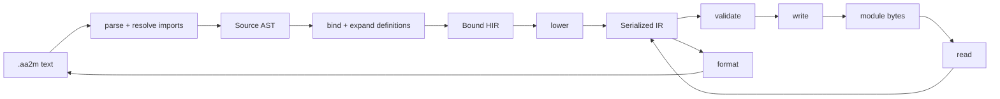

# Architecture

The compiler keeps three things apart: what the author wrote, what it means
once names are resolved, and the fields that end up in the binary. Code is
grouped by responsibility into layered packages, and the package root exports
nothing. The product is a standalone CLI and LSP server; there is no supported
Python embedding API.

Three trees carry a module through the compiler:

- `AST` (Abstract Syntax Tree) holds source constructs with their names,
  operators and spans.
- `HIR` (High-level Intermediate Representation) holds typed expressions and
  statements with resolved names and explicit defaults.
- `SIR` (Serialized Intermediate Representation) holds records with confirmed
  binary fields and IDs. It is the logical shape of the binary format; the
  codec that reads and writes bytes is separate.

Validation reports diagnostics and leaves SIR unchanged. The formatter reads
SIR directly and uses readable syntax only where that keeps every serialized
field.

## Code map

Packages sit in numbered layers, and a package imports only from its own layer
or lower ones. [`tools/check_layers.py`](../tools/check_layers.py) enforces
this as part of `mise run lint` (the table is `LAYERS`). It also rejects
imports inside functions, imports of another module's private names and import
cycles. One exception is allowed: the CLI imports `lsp.server.run` lazily so
that CLI startup does not load pygls.

| Layer | Package | Owns |
| --- | --- | --- |
| 0 | [`core/`](../aa2modulus/core/) | Source and binary locations, diagnostic values and the lexical rules for source names. `version.py` is also layer 0. |
| 1 | [`model/`](../aa2modulus/model/) | SIR records, typed values and binary32 bits, registry metadata records, display text for types and values, and control-flow action IDs. |
| 2 | [`binary/`](../aa2modulus/binary/) | The binary reader and writer, which need no metadata, with shared limit checks in `codec.py`. The wire layout and loader evidence are in [native format](native-format.md). |
| 2 | [`metadata/`](../aa2modulus/metadata/) | Generated registry resources, the registry loader and its shape checks, the indexed snapshot, native identities, lookup protocols, and registry schemas and errors. |
| 3 | [`language/`](../aa2modulus/language/) | The source-language policy, `policy.toml`: its model (`LanguagePolicy`), TOML reader, registry cross-checks and loader, plus the operator table, source types (`types.py`: `card`, widening, signatures derived from roles), documentation keys and the language catalog. |
| 4 | [`validation/`](../aa2modulus/validation/) | Strict and native semantic validation (`validator/`: reporter, labels, scope, expression, event-value, statement and module checks, suggested global declarations) and native GUI projection. |
| 5 | [`context/`](../aa2modulus/context/) | `SourceContext` (resolved metadata, policy, catalog, limits and import resolution), source budgets with their located error, and the import resolver protocol. |
| 6 | [`syntax/`](../aa2modulus/syntax/) | The grammar, the parser package (`parser/`: engine, errors, entry points, and a transformer with one mixin per grammar area), Source AST, AST walking (`walk.py`), qualified-name spans, import resolution, and text, tree and AST budgets. |
| 6 | [`syntax/recovery.py`](../aa2modulus/syntax/recovery.py) | Bounded LALR recovery that checkpoints and rolls back over production tokens. The editor's current-buffer view uses it, and so does the strict path to report every syntax error (`syntax_diagnostics`). [`syntax/braces.py`](../aa2modulus/syntax/braces.py) adds the brace-pair hint to those errors. |
| 6 | [`syntax/lexicon.py`](../aa2modulus/syntax/lexicon.py) | Every grammar literal sorted into one group, the literal patterns and comments, and the syntax fingerprint the server advertises. A grammar change that the classification table does not cover raises. |
| 6 | [`syntax/scanner.py`](../aa2modulus/syntax/scanner.py) | The error-tolerant lexical scan used for highlighting: lexicon words, operators, `@allow` codes, numbers, strings and per-line comments, without a parse. A lexicon group or literal pattern missing from its table raises. |
| 6 | [`syntax/hints.py`](../aa2modulus/syntax/hints.py) | Help and exact fixes for common mistakes carried over from other languages. Syntax hints probe the failed parser state; the binder's unknown-name paths share the keyword table. |
| 7 | [`hir/`](../aa2modulus/hir/) | Bound HIR nodes, recorded symbol references and resolved constants, the binding work budget and HIR budgets. |
| 8 | [`lowering/`](../aa2modulus/lowering/) | HIR to SIR: expressions, events, GUI action trees and modules. |
| 9 | [`semantics/`](../aa2modulus/semantics/) | Binding (`binding/`: state, reporting, rewrites, suggestions, values, declarations, constants, members, expressions, checks, macro calls, targets, statements, triggers, definitions, module, authoring) and definition expansion. |
| 9 | [`semantics/allows.py`](../aa2modulus/semantics/allows.py) | `@allow` acknowledgement. After validation, and in definition validation, it downgrades the hazard errors an attribute covers and reports problems with the attributes themselves. |
| 9 | [`decompile/`](../aa2modulus/decompile/) | Formatting SIR back to source text (`format/`: text, context, cards, expressions, inference, fallbacks, statements, module). |
| 10 | [`pipeline/`](../aa2modulus/pipeline/) | Compiler drivers. [`analysis.py`](../aa2modulus/pipeline/analysis.py) is the shared driver; it keeps completed stages, diagnostics and resolved import edges for the editor. `authoring.py` is the editor's current-buffer view. |
| 11 | [`app/`](../aa2modulus/app/) | Use cases: validate and compile source (`compile.py`), recover source with diagnostics (`decompile.py`), the editor built-ins catalog with compile-checked examples, Markdown pages and ranked search (`editor_catalog/`), the editor lexicon document (`editor_lexicon.py`), and the release manifest with the contract version and feature flags that `initialize` also advertises (`editor_manifest.py`). |
| 12 | [`cli/`](../aa2modulus/cli/) | Commands (`commands/`), argument parsing, streams, exit codes, inspection and diagnostic rendering (`render/`). `__main__.py` is also layer 12. |
| 12 | [`lsp/`](../aa2modulus/lsp/) | The stdio server (`server/`), protocol conversion (`protocol/`), versioned buffers and the lazy workspace index (`workspace/`), completion, signature help, documentation, references, rename, semantic tokens and inlay hints (`features/` and sibling packages), and module commands (`commands/`). |
| 13 | [`aa2modulus/__init__.py`](../aa2modulus/__init__.py) | A docstring and nothing else. Import from the owning module. |

Maintenance scripts and tests:

| Location | Responsibility |
| --- | --- |
| [`tools/`](../tools/) | Maintenance scripts, one job each. A script's components live in its own package. |
| [`tools/generate_registry.py`](../tools/generate_registry.py), [`tools/registry/`](../tools/registry/) | Registry generation and `--check` from a pinned AAUnlimited source checkout given with `--source-root`: reading the C++ tables and writing the manifest. |
| [`tools/generate_builtins_pages.py`](../tools/generate_builtins_pages.py) | The website's built-ins pages (`docs/reference/builtins/`) from the editor catalog, with `--check`. |
| [`tools/build.py`](../tools/build.py), [`tools/standalone/`](../tools/standalone/) | The native single-file build, with its notice writer and version smoke check. |
| [`tools/release_manifest.py`](../tools/release_manifest.py) | Merges the per-platform manifest fragments into the release's `aa2modulus-manifest.json`. Standard library only. |
| [`tools/check_layers.py`](../tools/check_layers.py) | The layer, lazy-import, private-import and import-cycle check (part of `mise run lint`). |
| [`tests/`](../tests/) | Scenario tests grouped by source, binary, metadata, CLI and LSP, with shared helpers in `support/`. The product contract is the standalone CLI and LSP, not a Python API. |

## Representations and invariants

- The [Source AST](../aa2modulus/syntax/ast.py) keeps names, operators,
  omitted arguments, grouping, spans, imports, definitions and raw payloads.
- [Bound HIR](../aa2modulus/hir/nodes.py) holds the selected identities, typed
  expressions, explicit defaults, expanded statements and source control flow.
  Its types are source types. `card` is a separate enum member, so code typed
  for the wire `TypeId` cannot receive it; it appears on variables,
  declarations, card-role calls and `Card(...)`, and lowering writes `int`.
  Definitions and diagnostics never become serialized records.
- [SIR](../aa2modulus/model/records.py) mirrors confirmed binary fields.
  Constructors enforce structural and payload invariants, and unknown IDs
  survive when metadata is missing. Equality and logical IR ignore provenance,
  locations and resolved metadata. Value equality compares exact binary32 bits,
  NaN payloads included.

`to_ir` and `from_ir` convert SIR to and from logical IR. They are separate
from the binary codec, and restoring logical IR does not restore annotations.
Model and location modules never import loaders, source passes or codecs.

## Rule owners

| Rule | Owner |
| --- | --- |
| Fixed syntax, precedence, literals and spans | [grammar](../aa2modulus/syntax/grammar/unified.lark), [parser](../aa2modulus/syntax/parser/), [operator table](../aa2modulus/language/operators.py) |
| Name and type resolution, complete-trigger scope, defaults, definition validation, template hygiene, and lowering receiver calls into native argument vectors | [binding](../aa2modulus/semantics/binding/) |
| Definition dependencies, typed substitution and expansion preflight | [expansion](../aa2modulus/semantics/expansion.py) |
| Explicit library access, canonical identity, the import graph and origins | [imports](../aa2modulus/syntax/imports.py) |
| HIR to native IDs and nested GUI trees; `card` to `int` | [lowering](../aa2modulus/lowering/) |
| Strict authoring checks and pinned native checks | [validator](../aa2modulus/validation/validator/) |
| Safe readable projection, raw fallbacks, projection errors, and `card` inference with `Card(...)` conversions | [formatter](../aa2modulus/decompile/format/module.py) |
| Native GUI display, conservative fallbacks and inspection grouping by fixed operator precedence | [inspection](../aa2modulus/cli/inspection.py) |
| Wire order, widths, payloads and codec limits ([layout](native-format.md)) | [reader](../aa2modulus/binary/reader.py), [writer](../aa2modulus/binary/writer.py) |
| Configuration conflicts and source resource budgets | [context](../aa2modulus/context/operation.py), [limits](../aa2modulus/context/limits.py), [syntax budgets](../aa2modulus/syntax/limits.py), [binding and HIR budgets](../aa2modulus/hir/limits.py) |
| Registry JSON validation and typed construction | [registry](../aa2modulus/metadata/registry.py) |
| Immutable native row and wire targets, and source candidates | [catalog](../aa2modulus/language/catalog/), [identities](../aa2modulus/metadata/identities.py) |
| Policy TOML reading, derived signatures, the receiver member-form schema and slot-0 mapping, registry cross-checks | [policy reader](../aa2modulus/language/reader.py), [policy model](../aa2modulus/language/policy.py), [policy values](../aa2modulus/language/values.py), [policy validation](../aa2modulus/language/validation/) |
| Native GUI flattening and located discarded controls | [projection](../aa2modulus/validation/projection.py) |

## Binding and definitions

In a trigger's complete declaration vector, globals come before all locals.
Definition formals bind in their own scopes, and the actual arguments
substitute expressions that are already bound. An argument used twice is
evaluated at each use, and an unused argument is still type-checked. Raw
arguments are validated before substitution can discard them. Template-local
renaming touches only records the definition owns, so identities bound by the
caller stay as they are. The [language contract](language-contract.md) has the
full rules for macros, imports and templates.

The parser builds its fixed grammar once, lazily, and gives each call its own
parser and transformer state. Reusing a context keeps the configuration;
symbols, import graphs, budgets and diagnostics belong to one operation.
Iterative checks of text, tree, AST and HIR size run before the recursive
passes, and depth ceilings protect those passes without raising Python's
recursion limit.

Strict binding collects independent errors at statement and item boundaries
(`bind_or_record` in `semantics/binding/reporting.py`). A declaration that
fails stays in scope, and a macro or template that fails is marked poisoned,
so its uses add no follow-on errors. A call with a single candidate binds all
its arguments and reports every argument error (`bind_arguments`). Other
expression binding and overload trials still stop at the first error. The
editor's authoring view sets no collector and does its own recovery.

Binding records each authored name use with the declaration or registry entry
it selected, in `BoundModule.references`, which is never serialized. Each
speculative overload keeps its own reference list, and only the one
successful selection is committed. One operation budget counts expression
visits and candidate attempts, rejected speculative work included. Uses inside
a definition are recorded once, in the definition's scope; expansion adds no
navigation records for generated names.

## Analysis driver

`analyze_source` keeps the authored root AST, the composed AST, Bound HIR and
SIR as each stage finishes. An input failure keeps the earlier stages and the
original exception; an unexpected exception propagates. Import edges include
resolved targets that failed to read, so the editor can invalidate when a
missing library appears. A resolution failure with no identity has no edge.

Validation and compilation use the strict diagnostics. Decompilation skips the
final semantic validation when it has already located findings in the
recovered text. Library analysis keeps an empty internal module for
definition checks, while the application functions still return no module for
a library. Each analysis belongs to one operation and keeps its exact input
text, which the editor uses to check freshness.

## Language server

The CLI loads the LSP package and pygls only for `lsp-server`. Each stdio
session owns immutable document snapshots and one compiler worker. The worker
waits 200 ms after a change and merges the pending roots, unless a request is
waiting for the analysis, which then starts at once; work for a buffer or
dependency that has since changed is dropped, and cancelling a request never
touches shared compiler state. The worker reads the captured overlays before
the filesystem resolver, and a failed analysis keeps the earlier dependency
edges.

Authoring features use the committed binding targets and a separate
current-buffer view, built from the shared grammar's checkpoints and
positioned Source AST recovery. Strict diagnostics, SIR and compilation never
see repaired syntax. Strict diagnostics use the same recovery only to list
more syntax errors after the parser's first one. There is no second expression
parser and no semantic model in the client.

- References and rename ([`lsp/features/references.py`](../aa2modulus/lsp/features/references.py))
  identify a declaration by its declaration span and collect committed binding
  targets across the analyses in scope. A rename is validated by analysing the
  edited texts again, so scope rules live in one place.
- Library declarations come from a lazy workspace index
  ([`lsp/workspace/index.py`](../aa2modulus/lsp/workspace/index.py)) of
  closed-file analyses. Each request checks it again against disk signatures
  and open buffers.
- Semantic tokens ([`lsp/features/semantic_tokens.py`](../aa2modulus/lsp/features/semantic_tokens.py))
  classify the same binding targets plus authored declaration spans, then add
  the lexical scan's tokens wherever no name token covers them. The client
  needs no catalog or keyword list to colour code.
- Inlay hints ([`lsp/features/inlay_hints.py`](../aa2modulus/lsp/features/inlay_hints.py))
  pair call syntax with those targets to show parameter names.
- Where the binder's `help` names one concrete rewrite, it also attaches a
  structured `SourceFix` edit (`Diagnostic.fixes`). The CLI prints only
  `help`; [`lsp/protocol/diagnostics.py`](../aa2modulus/lsp/protocol/diagnostics.py)
  puts the fixes in the diagnostic's `data` for code actions.

The [language server guide](lsp.md) covers user-visible behaviour, completion,
module commands and the client wire contract.

## Standalone build

The standalone console executable uses the same CLI dispatcher and keeps the
LSP import lazy. PyInstaller belongs to the `build` dependency group, and the
grammar, registry and policy files keep their package-relative paths. The
build smoke-checks both `--version` outputs and writes notices and hashes next
to the executable. The [standalone guide](standalone.md) has the platform
requirements. The AAUnlimited source is never a build input.

## Validation and recovery

Raw syntax keeps its exact representation and still goes through the strict
authoring checks. The SIR validator ignores `raw_reference`; those annotations
are for formatting and structural writing. Prepared definitions go through
the same SIR validator as emitted modules, raw arguments included, before
substitution. Parse-then-encode and decode-then-encode give structural
recovery.

Decompilation returns the recovered source, the original decode result, and
fallback and semantic diagnostics. It locates those diagnostics by parsing the
recovered text again and matching structural paths
([`core/locations.py`](../aa2modulus/core/locations.py) `source_span_index`).
An acknowledgeable error is anchored, by binary path, to the smallest
recovered statement, event or local, and the formatter writes the `@allow`
line there before that parse. Only the CLI renders diagnostics (snippets,
colour, summaries) in [`cli/render/`](../aa2modulus/cli/render/); the
libraries and the LSP never print.

Dependency strings are native metadata the module keeps. The validator reports
empty, self and duplicate names as strict errors or native warnings. The names
supply no globals and no module dependency graph, and recovery keeps every
string in its order, invalid ones included. The diagnostic for an undefined
variable suggests declaring it as a module global
([`validation/validator/declarations.py`](../aa2modulus/validation/validator/declarations.py)).

Native validation works on projected expression roots. Conditional children
reset branch and loop state; other child recursion copies branch state and
shares the loop patch lists. Compilation writes the original GUI tree. The
[projection tests](../tests/binary/test_runtime_projection.py) and the original
[native fixtures](https://github.com/AA2Depot/AA2Modulus/blob/main/tests/fixtures/modules/README.md)
are separate evidence. Checks run in Python do not prove how the game, built
with MSVC on Windows, executes a module.

Event-value checks compare the policy's `[event_values]` with every known
trigger event. Expanded SIR carries the macro, import and template call sites
and the original source locations. A free macro defers its event checks to
the places it is called. A trigger without a known event gets an
unknown-context warning. Strict declaration compatibility and native re-save
hazards are separate checks from callback value types.

## Metadata and catalog

Registry JSON becomes typed entries before it is indexed. Named constants are
looked up by explicit ID first, then by position; the source policy targets
explicit scoped IDs. Lowering reads no catalog files when no resolver is
supplied.

`SourceContext.catalog` combines the registry facts and policy event values
with the resolved policy once, and context replacements within an operation
reuse it. A process loads the shipped registry and policy once and builds one
catalog per metadata and policy pair (`language_catalog`). The catalog keeps
the lookup row, wire identity, native declaration, event values and native
save and reload identity apart. Binding, formatting, completion, signature help
and the editor built-ins catalog all use its checked candidates and canonical
forms. A literal source value becomes an ordinary `BoundLiteral` that points
at its native row for documentation; the serialized literal keeps no source
alias.

A custom registry uses its own evidence. A provider that only supports lookup
exposes an incomplete catalog, with no invented callback facts and no
fingerprint. The [metadata guide](metadata.md) covers schemas, fingerprints
and editing rules, and [development](development.md) covers the checks.
